# TerraAnalog — System Architecture Document

## 1. System Overview

**TerraAnalog** is an enterprise-grade geospatial architecture designed to bridge Earth observation data with lunar and Martian exploration requirements. The platform provides a multi-functional framework to search, classify, validate, and ethically evaluate terrestrial analogs.

---

## 2. Component Hierarchy

The system consists of five decoupled layers:

1. **External Data Provider Layer**:
   - NASA Earthdata (CMR, GIBS, SEDAC)
   - NASA Planetary Data System (PDS Geosciences Node: LRO Diviner, LOLA, MGS MOLA, MRO CRISM)
   - European Space Agency (Copernicus Data Space Ecosystem STAC, ESA WorldCover)
   - Canadian Space Agency (RADARSAT Constellation Mission)
   - Japan Aerospace Exploration Agency (JAXA G-Portal)
   - Mexican Geospatial Agencies (CONABIO Biodiversity Geoportal, INEGI Land Cover)
   - UNEP-WCMC / IUCN Protected Planet (WDPA)

2. **Ingestion & Adapter Layer (`app/sources/`)**:
   - Independent adapters implementing standard contracts (`search`, `get_metadata`, `get_assets`, `healthcheck`).
   - Normalization of diverse metadata formats (ISO 19115, STAC 1.0.0, PDS4, GeoJSON).
   - Integration status tracking: `catalog_only`, `visualization_only`, `download_available`, `processed`, `requires_credentials`.

3. **Geospatial & Feature Extraction Engine (`app/geospatial/`, `app/features/`)**:
   - Geodetic (WGS84) to local East-North-Up (ENU) Cartesian transformations for AR.
   - Bounding box and polygonal spatial intersections.
   - Standardized physical variable definitions with calibrated measurement units.

4. **Scientific Analysis & AI Gateway (`app/similarity/`, `app/reverse_search/`, `app/environment/`, `app/simulation/`)**:
   - **Similarity Engine**: Multi-objective Gaussian kernel calculation ($s_i = \exp(-0.5 (d_i / \tau_i)^2)$) with data quality weighting and coverage penalty.
   - **Reverse AI Search Engine**: Deterministic NLP parser extracting semantic criteria, lithology classes, and numerical ranges into vector filters.
   - **Environment & SDG Engine**: Intersection analysis with Protected Planet (WDPA) and ESA WorldCover; tracks UN Sustainable Development Goals (SDG 13, 14, 15) and manages a persistent damage event log.
   - **Simulation Engine**: Hardware stress modeling for rover mobility (wheel slippage, power multiplier) and thermal cycling.

5. **Presentation & Workstation Layer (`frontend/`)**:
   - High-contrast, minimalist scientific dark UI centered on an interactive Leaflet/MapLibre map.
   - Three-dimensional WebGL/Canvas terrain mesh generator with heads-up display (HUD) telemetry.
   - Dynamic dimensional radar charts and mathematical breakdown tables.

---

## 3. Data Flow Pipeline (Mandatory 5-Stage Architecture)

```mermaid
flowchart TD
    subgraph S1["1. Data Ingestion"]
        A1["User Selects Planetary Target (Moon / Mars)"] --> A2["Ingest Open Data (NASA, ESA, CSA, CONABIO, WDPA)"]
        A2 --> A3["Record Dataset Provenance, CRS & Calibration"]
    end

    subgraph S2["2. Order & Standardize"]
        A3 --> B1["Harmonize Coordinate Reference Systems"]
        B1 --> B2["Zonal Statistics on Terrestrial Candidates"]
        B2 --> B3["Massive Discard Filter (Roughness, Incline)"]
        B3 --> B4["Flag Missing Variables (Zero Hallucination)"]
    end

    subgraph S3["3. Mathematical Similarity"]
        B4 --> C1["Compute Gaussian Similarity per Variable s_i"]
        C1 --> C2["Weight by Importance (w_i) and Quality (q_i)"]
        C2 --> C3["Calculate Overall Physical Similarity Score"]
        C3 --> C4["Calculate Data Coverage Index"]
    end

    subgraph S4["4. Classification"]
        C4 --> D1["Physical Match: High / Moderate / Partial / Low"]
        D1 --> D2["Evaluate Provisional Flag (Coverage < 60%)"]
        D2 --> D3["Independent Operational Feasibility Score"]
        D3 --> D4["Independent Environmental Risk Assessment"]
    end

    subgraph S5["5. Return & Visualization"]
        D4 --> E1["Interactive Map Viewport (Color-Coded Markers)"]
        E1 --> E2["Candidate Detail Inspector & Radar Chart"]
        E2 --> E3["Environmental & SDG (13, 14, 15) Alerts"]
        E3 --> E4["AR Scene Preview & Local ENU 3D Terrain Grid"]
    end
```

---

## 4. Complete Relational Data Model (13 Entities)

1. **`data_sources`**: Open spatial data providers (`id`, `name`, `provider`, `base_url`, `access_type`, `license`, `requires_auth`, `status`, `last_checked_at`).
2. **`datasets`**: Scientific collections (`id`, `source_id`, `external_id`, `title`, `body`, `instrument`, `product_type`, `spatial_resolution`, `temporal_range`, `crs`, `metadata_json`, `access_status`, `citation_text`).
3. **`data_assets`**: Physical raster/vector files or tiles (`id`, `dataset_id`, `asset_url`, `local_path`, `media_type`, `checksum`, `asset_role`, `processing_status`).
4. **`candidate_regions`**: Terrestrial analog candidates (`id`, `name`, `country`, `region_type`, `latitude`, `longitude`, `bounding_box`, `geometry_geojson`, `area_km2`, `elevation_m`, `description`, `candidate_status`, `is_demo`).
5. **`target_profiles`**: Planetary exploration targets (`id`, `body`, `name`, `mission_context`, `latitude`, `longitude`, `description`, `target_environment`, `version`, `is_active`, `metadata_json`).
6. **`feature_definitions`**: Physical variables catalog (`id`, `key`, `name`, `category`, `unit`, `data_type`, `default_weight`, `tolerance`, `description`).
7. **`feature_measurements`**: Quantitative measurements (`id`, `feature_id`, `region_id`, `target_profile_id`, `value_numeric`, `value_text`, `unit`, `quality`, `dataset_id`, `method`, `measured_at`, `is_demo`).
8. **`similarity_runs`**: Execution log of similarity calculations (`id`, `target_profile_id`, `algorithm_version`, `parameters_json`, `candidate_count`, `status`, `created_at`).
9. **`similarity_results`**: Scored candidates per run (`id`, `run_id`, `region_id`, `physical_similarity`, `data_coverage`, `confidence`, `classification`, `operational_feasibility`, `environmental_risk_level`, `dimension_scores_json`, `breakdown_json`, `missing_json`, `is_provisional`).
10. **`environmental_assessments`**: Ecological evaluations (`id`, `region_id`, `assessment_date`, `risk_level`, `coverage_score`, `protected_area_intersection`, `protected_area_name`, `iucn_category`, `sdg13_climate_impact`, `sdg14_marine_connectivity`, `sdg15_terrestrial_ecosystems`, `findings_json`, `recommendation`).
11. **`environment_events`**: Persistent damage register (`id`, `region_id`, `event_type`, `severity`, `status`, `description`, `activity`, `impact_type`, `evidence_url`, `source_id`, `observed_at`, `created_at`, `reviewer`, `mitigation_json`).
12. **`simulation_runs`**: Testing scenarios (`id`, `region_id`, `scenario_name`, `scenario_type`, `parameters_json`, `output_json`, `model_version`, `status`).
13. **`ar_sessions`**: AR field contracts (`id`, `region_id`, `origin_geodetic`, `coordinate_reference`, `scene_asset_url`, `overlay_layers_json`, `observations_json`).
14. **`processing_jobs`**: Asynchronous batch queue (`id`, `job_type`, `status`, `progress`, `params_json`, `error_message`, `started_at`, `finished_at`).

---

## 5. Augmented Reality (AR) Coordinate Transformations

To bridge orbital planetary imagery with in-situ field exploration, TerraAnalog converts geodetic WGS84 coordinates $(\phi, \lambda, h)$ into a metric East-North-Up (ENU) Cartesian frame:

1. **Geodetic to Earth-Centered Earth-Fixed (ECEF)**:
   $$N(\phi) = \frac{a}{\sqrt{1 - e^2 \sin^2 \phi}}$$
   $$X = (N + h) \cos \phi \cos \lambda$$
   $$Y = (N + h) \cos \phi \sin \lambda$$
   $$Z = (N(1 - e^2) + h) \sin \phi$$

2. **ECEF to Local Tangent Plane (ENU)**:
   $$\begin{bmatrix} x_{\text{east}} \\ y_{\text{north}} \\ z_{\text{up}} \end{bmatrix} = \begin{bmatrix} -\sin \lambda_0 & \cos \lambda_0 & 0 \\ -\sin \phi_0 \cos \lambda_0 & -\sin \phi_0 \sin \lambda_0 & \cos \phi_0 \\ \cos \phi_0 \cos \lambda_0 & \cos \phi_0 \sin \lambda_0 & \sin \phi_0 \end{bmatrix} \begin{bmatrix} X - X_0 \\ Y - Y_0 \\ Z - Z_0 \end{bmatrix}$$

This produces a metric grid centered on the field astronaut or rover datum $(0, 0, 0)$ allowing seamless projection of slope hazard polygons and ecological exclusion fences on AR visors.
