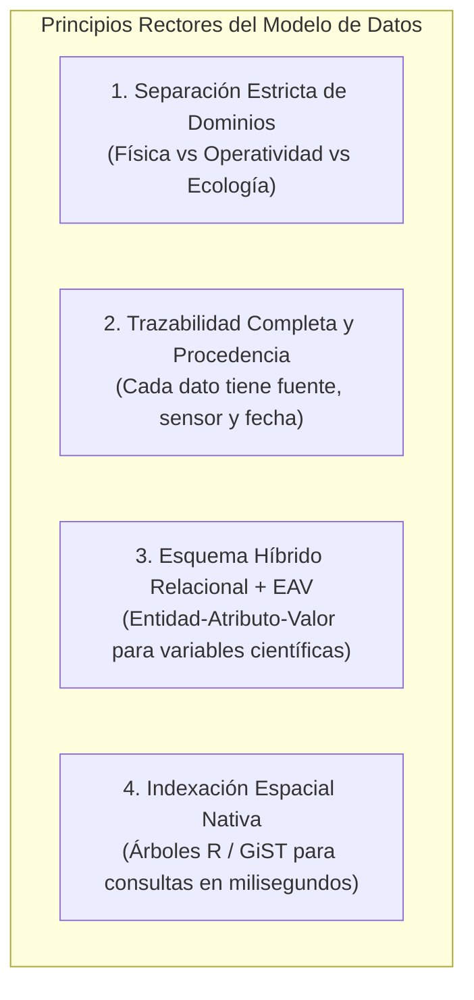
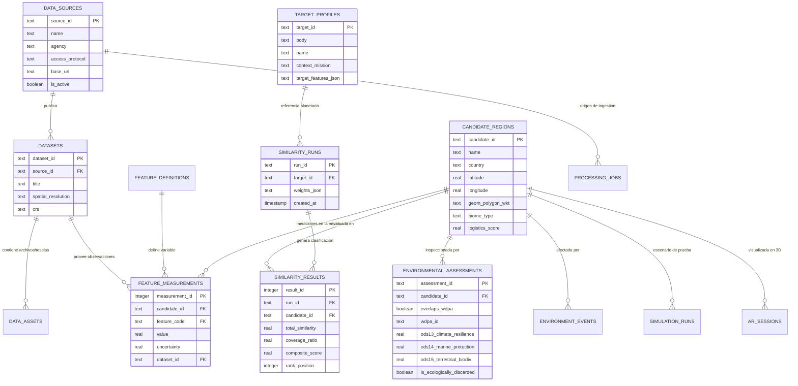

# TerraAnalog — Arquitectura y Especificación Completa de Bases de Datos

> **Documento Maestro de Ingeniería de Datos y Persistencia Espacial**  
> **Plataforma:** TerraAnalog (Validación y Descubrimiento de Análogos Planetarios)  
> **Estándar Espacial:** OGC Simple Features for SQL / PostGIS / SQLite SpatiaLite  
> **Sistema Geodésico:** WGS84 (EPSG:4326) / ECEF (EPSG:4978) / IAU 2000 Mars & Moon  
> **Fecha:** Noviembre 2026

---

## 1. Filosofía de Diseño y Principios Rectores

El modelo de datos de **TerraAnalog** está diseñado bajo cuatro principios de integridad científica y computacional:



### 1.1 ¿Por qué la separación de variables físicas, operativas y ecológicas?
En la literatura geológica y aeroespacial previa, muchos sistemas cometían el grave error metodológico de calcular un único "Score de Idoneidad" que promediaba la similitud del suelo junto con la cercanía a un aeropuerto o la fragilidad ecológica.
- **Consecuencia de ese error:** Un sitio que es 99% idéntico a Marte en mineralogía pero está a 200 km de una carretera recibía una calificación mediocre, ocultando un análogo científico invaluable. O peor: un sitio ecológicamente frágil pero accesible recibía una calificación alta y provocaba destrucción de ecosistemas.
- **Solución TerraAnalog:** La base de datos desacopla formalmente la **Similitud Física** (`similarity_results`), la **Viabilidad Operativa** (`candidate_regions.logistics_score`), y el **Riesgo Ambiental** (`environmental_assessments`). Una reserva protegida nunca altera la física del suelo; en su lugar, activa una bandera de **Descarte Binario No Negociable** (`is_ecologically_discarded = TRUE`).

---

## 2. Diagrama Entidad-Relación Global (14 Tablas)

A continuación se presenta el diagrama relacional completo que rige la persistencia de TerraAnalog:



---

## 3. Especificación Detallada de Cada Tabla

### 3.1 `data_sources` (Proveedores y Agencias Espaciales)
Registra las agencias y consorcios internacionales que proveen los datos científicos abiertos.
- **`source_id`** (`TEXT`, PK): Identificador único mnemónico (ej. `'NASA_CMR'`, `'ESA_COPERNICUS'`, `'UNEP_WDPA'`).
- **`name`** (`TEXT`, NOT NULL): Nombre oficial (`'NASA Common Metadata Repository'`).
- **`agency`** (`TEXT`): Agencia responsable (`'NASA'`, `'ESA'`, `'CONABIO'`, `'UNEP-WCMC'`).
- **`access_protocol`** (`TEXT`): Protocolo de transporte (`'REST_JSON'`, `'OGC_WMS'`, `'PDS4_STREAM'`).
- **`base_url`** (`TEXT`): Endpoint raíz de la API del proveedor.
- **`auth_type`** (`TEXT`): Tipo de autenticación (`'OPEN'`, `'BEARER_TOKEN'`, `'API_KEY'`).
- **`status`** (`TEXT`): Estado de salud del conector (`'ONLINE'`, `'DEGRADED'`, `'OFFLINE'`).

---

### 3.2 `datasets` (Colecciones Científicas de Datos)
Cataloga cada producto de datos derivado o sensor de observación satelital/planetaria.
- **`dataset_id`** (`TEXT`, PK): Ej. `'ASTER_GDEM_V3'`, `'CRISM_MTR3'`, `'LOLA_GDR'`.
- **`source_id`** (`TEXT`, FK -> `data_sources.source_id`): Proveedor del dataset.
- **`title`** (`TEXT`): Descripción técnica de la colección.
- **`variable_domain`** (`TEXT`): Dominio biofísico (`'TOPOGRAPHY'`, `'MINERALOGY'`, `'THERMAL_IR'`).
- **`spatial_resolution`** (`TEXT`): Resolución nativa (ej. `'30m'`, `'10m'`, `'1 arc-second'`).
- **`temporal_coverage`** (`TEXT`): Ventana de adquisición de las misiones.
- **`crs`** (`TEXT`): Sistema de Coordenadas de Referencia nativo (ej. `'EPSG:4326'`, `'IAU_2000_MARS'`).

---

### 3.3 `data_assets` (Archivos, Granos y Teselas Raster)
Mapea los recursos binarios individuales descargados o enlazados (GeoTIFFs, HDF5, Cloud Optimized GeoTIFFs - COG).
- **`asset_id`** (`TEXT`, PK): UUID o hash SHA256 del activo.
- **`dataset_id`** (`TEXT`, FK -> `datasets.dataset_id`): Dataset padre.
- **`granule_ur`** (`TEXT`): Identificador único del grano en NASA CMR o PDS.
- **`bbox_west`, `bbox_south`, `bbox_east`, `bbox_north`** (`REAL`): Bounding box geodésico en grados decimales.
- **`file_format`** (`TEXT`): Formato del archivo (`'COG'`, `'GeoTIFF'`, `'NetCDF'`, `'GeoJSON'`).
- **`storage_uri`** (`TEXT`): Ruta local o URL remota de acceso.

---

### 3.4 `candidate_regions` (Candidatos Análogos Terrestres)
Almacena las regiones del planeta Tierra caracterizadas para validación análoga.
- **`candidate_id`** (`TEXT`, PK): Clave primaria (ej. `'PINACATE'`, `'ATACAMA'`, `'HAUGHTON'`).
- **`name`** (`TEXT`, NOT NULL): Nombre geográfico del sitio.
- **`country`** (`TEXT`): País de localización.
- **`continent`** (`TEXT`): Continente (ej. `'North America'`, `'Antarctica'`).
- **`latitude`, `longitude`** (`REAL`): Coordenadas geodésicas centrales del sitio (WGS84).
- **`elevation_masl`** (`REAL`): Elevación media sobre el nivel del mar en metros.
- **`geom_polygon_wkt`** (`TEXT`): Polígono poligonal exacto en formato Well-Known Text (WKT).
- **`biome_type`** (`TEXT`): Tipo de bioma (`'Volcanic Basalt'`, `'Hyper-Arid Desert'`, `'Polar Impact Crater'`).
- **`analog_target`** (`TEXT`): Cuerpo objetivo al que principalmente análogo (`'Mars'`, `'Moon'`, `'Both'`).
- **`logistics_score`** (`REAL`): Índice de accesibilidad logística [0.0 - 1.0] (pista de aterrizaje, agua, telecomunicaciones).
- **`research_station`** (`TEXT`): Estación científica cercana si existe (ej. `'Flashline Mars Arctic Research Station'`).

---

### 3.5 `target_profiles` (Perfiles Planetarios de Referencia)
Almacena los perfiles cuantitativos de sitios de aterrizaje en la Luna y Marte (ej. Jezero, Shackleton).
- **`target_id`** (`TEXT`, PK): Ej. `'JEZERO_CRATER_MARS'`, `'SHACKLETON_CRATER_MOON'`.
- **`body`** (`TEXT`, NOT NULL): `'Mars'` o `'Moon'`.
- **`name`** (`TEXT`): Nombre del sitio extraterrestre.
- **`mission_context`** (`TEXT`): Misión asociada (`'Mars 2020 Perseverance'`, `'Artemis III'`).
- **`target_features_json`** (`TEXT`): Diccionario JSON con los valores ideales $x_{ref,i}$ y tolerancias $\tau_i$.

```json
{
  "slope_mean": {"value": 5.2, "tolerance": 2.5, "unit": "deg"},
  "roughness": {"value": 0.22, "tolerance": 0.08, "unit": "dimensionless"},
  "thermal_inertia": {"value": 310, "tolerance": 60, "unit": "J m^-2 K^-1 s^-1/2"},
  "fe_ox_ratio": {"value": 0.35, "tolerance": 0.10, "unit": "ratio"}
}
```

---

### 3.6 `feature_definitions` (Ontología de Variables Científicas)
Define formalmente cada variable física para asegurar estandarización y evitar ambigüedades.
- **`feature_code`** (`TEXT`, PK): Clave técnica (ej. `'slope_mean'`, `'roughness'`, `'fe_ox_ratio'`).
- **`display_name`** (`TEXT`): Nombre legible (`'Pendiente Media'`, `'Rugosidad Superficial'`).
- **`category`** (`TEXT`): Categoría (`'TOPOGRAPHY'`, `'SPECTRAL'`, `'GEOPHYSICAL'`, `'ATMOSPHERIC'`).
- **`unit`** (`TEXT`): Unidad de medida del Sistema Internacional (`'degrees'`, `'W/m^2'`, `'mGal'`).
- **`valid_min`, `valid_max`** (`REAL`): Rango físico válido para rechazo automático de outliers.
- **`default_tolerance_tau`** (`REAL`): Dispersión gaussiana predeterminada $\tau_i$.

---

### 3.7 `feature_measurements` (Mediciones Científicas EAV)
Implementa el patrón **Entidad-Atributo-Valor (EAV)** con trazabilidad de procedencia.
- **`measurement_id`** (`INTEGER`, PK AUTOINCREMENT).
- **`candidate_id`** (`TEXT`, FK -> `candidate_regions.candidate_id`).
- **`feature_code`** (`TEXT`, FK -> `feature_definitions.feature_code`).
- **`value`** (`REAL`, NOT NULL): Valor numérico medido en el análogo terrestre.
- **`uncertainty`** (`REAL`): Desviación estándar o error instrumental $\pm \sigma$.
- **`dataset_id`** (`TEXT`, FK -> `datasets.dataset_id`): Dataset que originó la medición.
- **`sensor_instrument`** (`TEXT`): Instrumento científico (ej. `'ASTER SWIR Band 4/7'`, `'PALSAR SAR L-band'`).
- **`measured_at`** (`TIMESTAMP`): Fecha de adquisición o consolidación.

---

### 3.8 `similarity_runs` (Sesiones de Ejecución Algorítmica)
Registra cada ejecución del motor de comparación para garantizar **reproducibilidad científica absoluta**.
- **`run_id`** (`TEXT`, PK): UUID único de la sesión.
- **`target_id`** (`TEXT`, FK -> `target_profiles.target_id`): Perfil planetario contra el que se contrastó.
- **`weights_json`** (`TEXT`): Vector de ponderaciones utilizado $\vec{w}$.
- **`algorithm_version`** (`TEXT`): Versión del kernel matemático (ej. `'Gaussian-Kernel-v2.1'`).
- **`user_agent`** (`TEXT`): Identificador del cliente o workflow ejecutor.
- **`created_at`** (`TIMESTAMP` DEFAULT CURRENT_TIMESTAMP).

---

### 3.9 `similarity_results` (Puntuaciones y Clasificación de Análogos)
Almacena el desglose de similitud física por candidato para una ejecución dada.
- **`result_id`** (`INTEGER`, PK AUTOINCREMENT).
- **`run_id`** (`TEXT`, FK -> `similarity_runs.run_id`).
- **`candidate_id`** (`TEXT`, FK -> `candidate_regions.candidate_id`).
- **`total_similarity`** (`REAL`): Similitud física pura normalizada $S_{total} \in [0, 1]$.
- **`coverage_ratio`** (`REAL`): Proporción de variables con datos verificados $C \in [0, 1]$.
- **`composite_score`** (`REAL`): Puntuación compuesta $S_{comp} = S_{total} \times C$.
- **`rank_position`** (`INTEGER`): Posición en el ranking (1 = análogo más idéntico).
- **`breakdown_json`** (`TEXT`): Puntuación individual por variable $s_i = \exp\left(-\frac{1}{2}\left(\frac{d_i}{\tau_i}\right)^2\right)$.

---

### 3.10 `environmental_assessments` (Evaluación de Impacto ODS 13/14/15)
Monitorea la integridad ecológica del sitio según el estándar UNEP-WCMC y ODS de las Naciones Unidas.
- **`assessment_id`** (`TEXT`, PK): UUID de la auditoría.
- **`candidate_id`** (`TEXT`, FK -> `candidate_regions.candidate_id`).
- **`overlaps_wdpa`** (`BOOLEAN`): Verdadero si el análogo intersecta una Reserva Natural o Parque Nacional.
- **`wdpa_id`** (`TEXT`): Identificador oficial en la Base Mundial de Áreas Protegidas.
- **`iucn_category`** (`TEXT`): Categoría UICN (ej. `'Ia - Strict Nature Reserve'`, `'II - National Park'`).
- **`ods13_climate_resilience`** (`REAL`): Capacidad del sitio ante eventos climáticos extremos [0 - 100].
- **`ods14_marine_protection`** (`REAL`): Preservación de cuerpos acuíferos o costas adyacentes [0 - 100].
- **`ods15_terrestrial_biodiv`** (`REAL`): Índice de biodiversidad terrestre y suelo virgen [0 - 100].
- **`is_ecologically_discarded`** (`BOOLEAN`): Bandera de descarte para misiones de alto impacto destructivo.
- **`discard_rationale`** (`TEXT`): Explicación científica del descarte preventivo.

---

### 3.11 `environment_events` (Histórico de Eventos Ecológicos y Alertas)
Permite a los investigadores auditar eventos climáticos o regulatorios en tiempo real.
- **`event_id`** (`INTEGER`, PK AUTOINCREMENT).
- **`candidate_id`** (`TEXT`, FK -> `candidate_regions.candidate_id`).
- **`event_type`** (`TEXT`): Tipo de suceso (`'WILDFIRE'`, `'REGULATION_UPDATE'`, `'DROUGHT'`, `'AUDIT_PASSED'`).
- **`severity`** (`TEXT`): `'CRITICAL'`, `'WARNING'`, `'INFO'`.
- **`event_date`** (`DATE`).
- **`description`** (`TEXT`): Descripción del incidente y mitigación recomendada.

---

### 3.12 `simulation_runs` (Simulaciones Terramecánicas y Rover)
Guarda telemetría de pruebas sintéticas sobre los gemelos digitales de los análogos.
- **`simulation_id`** (`TEXT`, PK): UUID de la prueba.
- **`candidate_id`** (`TEXT`, FK -> `candidate_regions.candidate_id`).
- **`gravity_ms2`** (`REAL`): Gravedad aplicada ($1.62\text{ m/s}^2$ Luna, $3.72\text{ m/s}^2$ Marte, $9.81\text{ m/s}^2$ Tierra).
- **`rover_mass_kg`** (`REAL`): Masa del vehículo explorador (ej. 1025 kg clase Perseverance).
- **`mean_sinkage_cm`** (`REAL`): Hundimiento medio de rueda calculado según modelo Bekker.
- **`mean_slip_ratio`** (`REAL`): Patinaje medio porcentual de tracción.
- **`power_consumption_wh_km`** (`REAL`): Consumo energético estimado por kilómetro recorrido.
- **`radiation_seu_rate`** (`REAL`): Tasa estimada de Single Event Upsets por radiación cósmica.

---

### 3.13 `ar_sessions` (Sesiones de Visualización 3D y Realidad Aumentada)
- **`session_id`** (`TEXT`, PK).
- **`candidate_id`** (`TEXT`, FK -> `candidate_regions.candidate_id`).
- **`camera_fov`** (`REAL`): Campo de visión de la cámara virtual.
- **`wireframe_density`** (`INTEGER`): Resolución de la malla topográfica ENU.
- **`thermal_overlay_active`** (`BOOLEAN`): Si se renderizó el mapa térmico FLIR infrarrojo.
- **`created_at`** (`TIMESTAMP`).

---

### 3.14 `processing_jobs` (Cola Asíncrona de Ingestión ETL)
- **`job_id`** (`TEXT`, PK).
- **`source_id`** (`TEXT`, FK -> `data_sources.source_id`).
- **`job_type`** (`TEXT`): `'HARVEST_CMR'`, `'GENERATE_TERRAIN_MESH'`, `'RECOMPUTE_INDEXES'`.
- **`status`** (`TEXT`): `'PENDING'`, `'PROCESSING'`, `'COMPLETED'`, `'FAILED'`.
- **`error_log`** (`TEXT`): Registro detallado de excepciones en caso de fallo.
- **`started_at`, `finished_at`** (`TIMESTAMP`).

---

## 4. Consultas Espaciales y Flujo Operativo en SQL

A continuación se ilustran las consultas SQL reales utilizadas por el backend de TerraAnalog:

### Consulta 1: Intersección Espacial con Áreas Protegidas (PostGIS GiST)
```sql
-- Detección automática de superposición con Áreas Protegidas (WDPA)
SELECT 
    c.candidate_id,
    c.name AS candidate_name,
    w.wdpa_id,
    w.name AS protected_area_name,
    w.iucn_cat,
    ST_Area(ST_Intersection(c.geom_polygon, w.geom_polygon)) / ST_Area(c.geom_polygon) AS overlap_ratio
FROM 
    candidate_regions c
JOIN 
    wdpa_protected_areas w
ON 
    ST_Intersects(c.geom_polygon, w.geom_polygon)
WHERE 
    c.candidate_id = 'PINACATE';
```

### Consulta 2: Ponderación de Similitud Gaussiana con Cobertura
```sql
-- Extracción matricial de variables normalizadas para cálculo de distancia
SELECT 
    c.candidate_id,
    c.name,
    m.feature_code,
    m.value AS candidate_value,
    f.default_tolerance_tau,
    -- Cálculo de distancia al cuadrado normalizada por tolerancia
    POWER((m.value - json_extract(t.target_features_json, '$.' || m.feature_code || '.value')) / f.default_tolerance_tau, 2) AS squared_distance
FROM 
    candidate_regions c
JOIN 
    feature_measurements m ON c.candidate_id = m.candidate_id
JOIN 
    feature_definitions f ON m.feature_code = f.feature_code
JOIN 
    target_profiles t ON t.target_id = 'JEZERO_CRATER_MARS'
ORDER BY 
    c.candidate_id, m.feature_code;
```

---

## 5. Resumen de Gobernanza de Datos

| Dimensión | Enfoque en TerraAnalog |
| :--- | :--- |
| **Integridad Relacional** | Claves foráneas con restricciones `ON DELETE RESTRICT` para preservar auditorías científicas. |
| **Gobernanza Espacial** | Estándar WGS84 para la Tierra; marcos IAU para cuerpos planetarios externos. |
| **Privacidad y Licencias** | 100% datos abiertos gubernamentales e interinstitucionales (NASA, ESA, UNEP, INEGI). |
| **Tolerancia a Fallos** | Funciona de manera autónoma con almacenamiento local en SQLite y migración transparente a PostgreSQL/PostGIS. |
