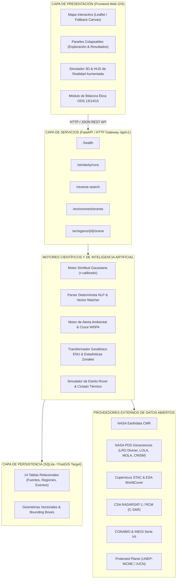
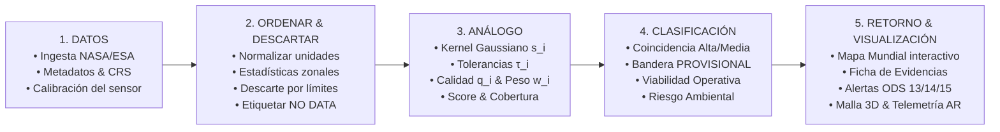
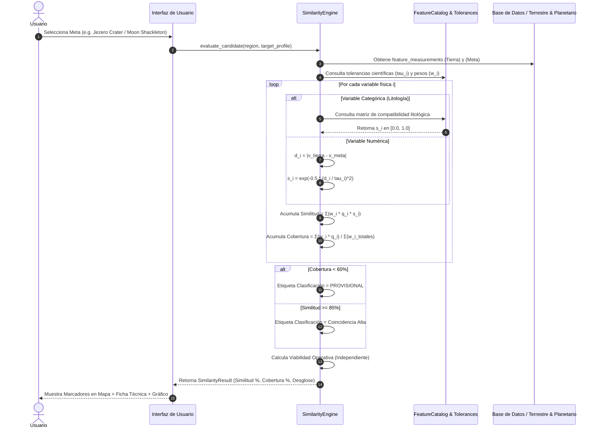
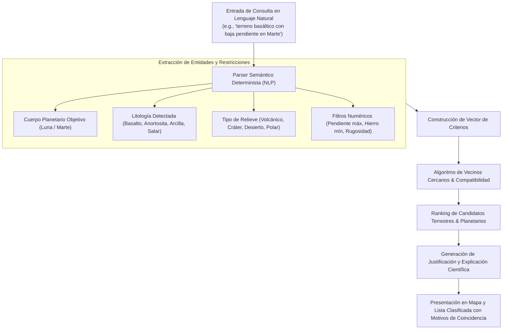
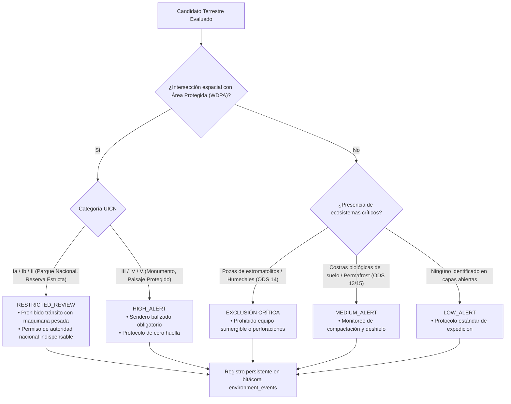
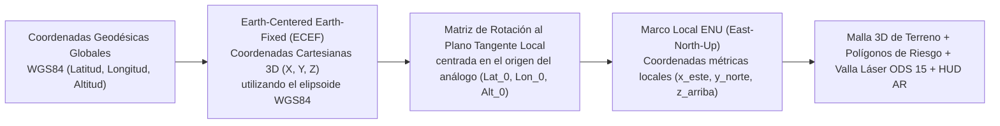
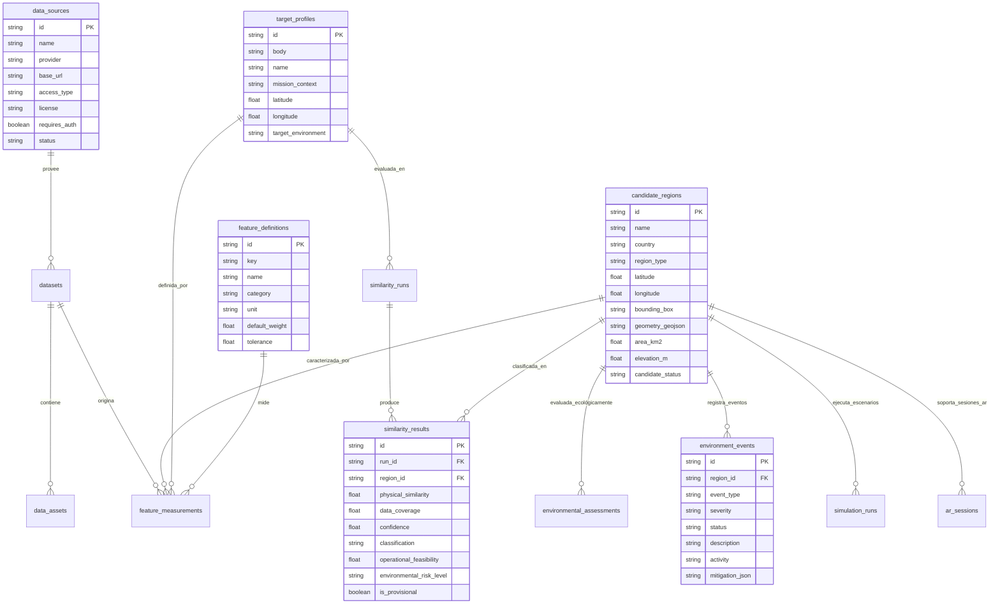
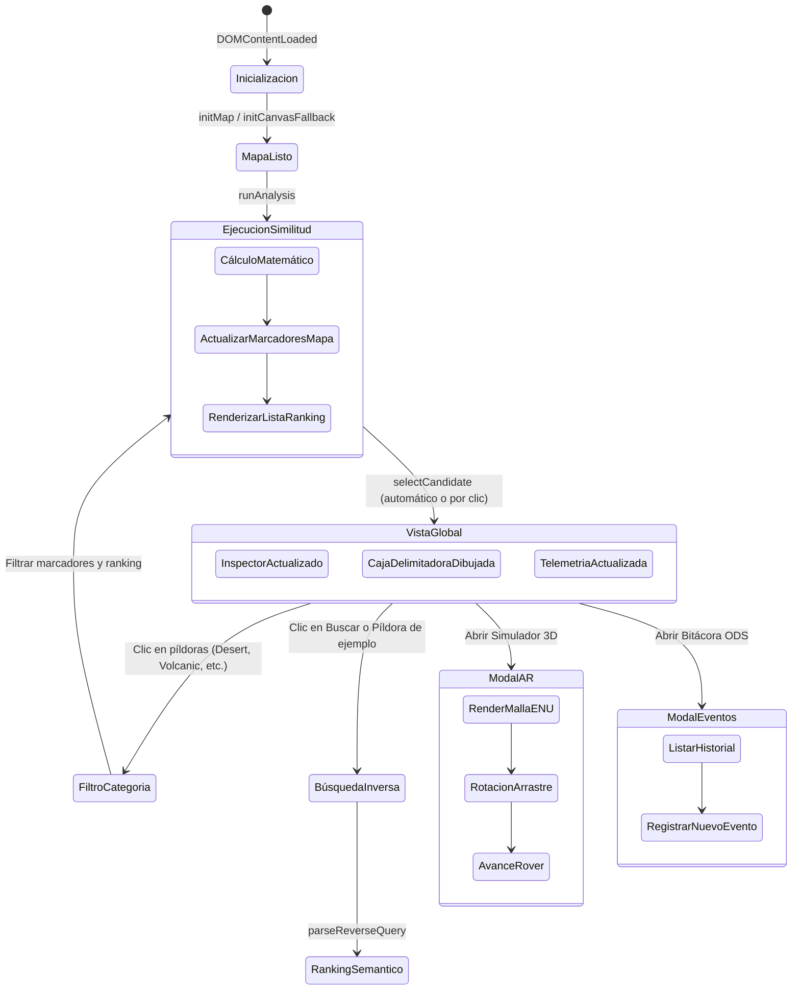

# TerraAnalog — Documentación Exhaustiva de Funciones y Diagramas del Sistema

Este documento proporciona la especificación técnica completa y detallada de **todas las funciones** que componen la plataforma **TerraAnalog**, junto con los **diagramas de arquitectura, flujo de datos, modelo entidad-relación y estado de ejecución**.

---

## ÍNDICE DE CONTENIDOS

1. [Diagramas del Sistema](#1-diagramas-del-sistema)
   - [Diagrama 1: Arquitectura Global y Conectividad de Capas](#diagrama-1-arquitectura-global-y-conectividad-de-capas)
   - [Diagrama 2: Pipeline Científico de 5 Etapas](#diagrama-2-pipeline-científico-de-5-etapas)
   - [Diagrama 3: Secuencia del Motor Matemático de Similitud Gaussiana](#diagrama-3-secuencia-del-motor-matemático-de-similitud-gaussiana)
   - [Diagrama 4: Flujo de Búsqueda Inversa con Inteligencia Artificial](#diagrama-4-flujo-de-búsqueda-inversa-con-inteligencia-artificial)
   - [Diagrama 5: Árbol de Decisión Ética y ODS (13, 14 y 15)](#diagrama-5-árbol-de-decisión-ética-y-ods-13-14-y-15)
   - [Diagrama 6: Pipeline de Transformación Geodésica a Realidad Aumentada (WGS84 -> ECEF -> ENU)](#diagrama-6-pipeline-de-transformación-geodésica-a-realidad-aumentada)
   - [Diagrama 7: Modelo Entidad-Relación de la Base de Datos (14 Entidades)](#diagrama-7-modelo-entidad-relación-de-la-base-de-datos)
   - [Diagrama 8: Máquina de Estados del Frontend e Interacción UI/UX](#diagrama-8-máquina-de-estados-del-frontend-e-interacción-uiux)
2. [Documentación de Funciones: Backend Python (`app/`)](#2-documentación-de-funciones-backend-python)
   - [2.1 Motor de Similitud (`app/similarity/engine.py`)](#21-motor-de-similitud-appsimilarityenginepy)
   - [2.2 Motor de Búsqueda Inversa por IA (`app/reverse_search/engine.py`)](#22-motor-de-búsqueda-inversa-por-ia-appreverse_searchenginepy)
   - [2.3 Motor Medioambiental y ODS (`app/environment/engine.py`)](#23-motor-medioambiental-y-ods-appenvironmentenginepy)
   - [2.4 Transformaciones Geoespaciales (`app/geospatial/transforms.py`)](#24-transformaciones-geoespaciales-appgeospatialtransformspy)
   - [2.5 Simulador Físico de Entorno (`app/simulation/engine.py`)](#25-simulador-físico-de-entorno-appsimulationenginepy)
   - [2.6 Contrato de Escena de Realidad Aumentada (`app/ar/scene.py`)](#26-contrato-de-escena-de-realidad-aumentada-apparscenepy)
   - [2.7 Adaptadores de Fuentes Abiertas (`app/sources/adapters.py`)](#27-adaptadores-de-fuentes-abiertas-appsourcesadapterspy)
   - [2.8 Controlador API REST (`app/api.py`)](#28-controlador-api-rest-appapipy)
   - [2.9 Servidor HTTP Gateway (`app/server.py`)](#29-servidor-http-gateway-appserverpy)
   - [2.10 Repositorio y Base de Datos (`app/database.py`)](#210-repositorio-y-base-de-datos-appdatabasepy)
3. [Documentación de Funciones: Frontend Web GIS (`frontend/js/`)](#3-documentación-de-funciones-frontend-web-gis)
   - [3.1 Motor Científico Cliente (`frontend/js/engine.js`)](#31-motor-científico-cliente-frontendjsenginejs)
   - [3.2 Simulador 3D de Terreno y HUD AR (`frontend/js/ar_sim.js`)](#32-simulador-3d-de-terreno-y-hud-ar-frontendjsar_simjs)
   - [3.3 Orquestador de la Aplicación (`frontend/js/app.js`)](#33-orquestador-de-la-aplicación-frontendjsappjs)

---

## 1. DIAGRAMAS DEL SISTEMA

### Diagrama 1: Arquitectura Global y Conectividad de Capas

---

### Diagrama 2: Pipeline Científico de 5 Etapas

---

### Diagrama 3: Secuencia del Motor Matemático de Similitud Gaussiana

---

### Diagrama 4: Flujo de Búsqueda Inversa con Inteligencia Artificial

---

### Diagrama 5: Árbol de Decisión Ética y ODS (13, 14 y 15)

---

### Diagrama 6: Pipeline de Transformación Geodésica a Realidad Aumentada

---

### Diagrama 7: Modelo Entidad-Relación de la Base de Datos

---

### Diagrama 8: Máquina de Estados del Frontend e Interacción UI/UX

---

## 2. DOCUMENTACIÓN DE FUNCIONES: BACKEND PYTHON

### 2.1 Motor de Similitud (`app/similarity/engine.py`)

#### `compute_variable_similarity(feature_key: str, earth_val: Any, target_val: Any, custom_tau: Optional[float] = None) -> Tuple[float, float, str]`
- **Propósito:** Calcula la similitud matemática entre una medición observada en la Tierra y el valor de referencia de la meta planetaria.
- **Parámetros:**
  - `feature_key` (`str`): Clave identificadora de la variable (e.g., `'slope_mean'`, `'lithology_type'`, `'iron_oxide_content'`).
  - `earth_val` (`Any`): Valor observado en el terreno terrestre (numérico o texto de clase).
  - `target_val` (`Any`): Valor de referencia en la superficie lunar o marciana.
  - `custom_tau` (`Optional[float]`): Sobrescritura opcional del parámetro de tolerancia científica $\tau_i$.
- **Retorno:** Tupla de 3 elementos `(similarity_score: float, delta: float, explanation: str)`:
  - `similarity_score`: Valor normalizado entre $0.0$ y $1.0$.
  - `delta`: Diferencia absoluta en unidades físicas ($|v_{\text{tierra}} - v_{\text{meta}}|$).
  - `explanation`: Cadena explicativa detallando la ecuación y el resultado.
- **Fórmula Matemática:**
  $$s_i = \exp\left(-0.5 \cdot \left(\frac{d_i}{\tau_i}\right)^2\right)$$
- **Manejo de Errores:** Si alguno de los valores es nulo o inválido, retorna `(0.0, 0.0, "Missing data")` sin alterar artificialmente el promedio.

#### `evaluate_candidate(region: Dict, target_profile: Dict, earth_measurements: List[Dict], target_measurements: List[Dict], run_id: str) -> SimilarityResult`
- **Propósito:** Ejecuta la evaluación multidimensional completa entre un sitio candidato terrestre y el perfil planetario objetivo.
- **Parámetros:**
  - `region` (`Dict`): Diccionario con datos de la región candidata (id, nombre, tipo, elevación).
  - `target_profile` (`Dict`): Diccionario de la meta planetaria (Luna/Marte).
  - `earth_measurements` (`List[Dict]`): Lista de todas las mediciones de variables terrestres registradas.
  - `target_measurements` (`List[Dict]`): Lista de mediciones correspondientes en la meta planetaria.
  - `run_id` (`str`): Identificador único de la corrida de análisis.
- **Retorno:** Objeto `SimilarityResult` que encapsula:
  - `physical_similarity`: Porcentaje ponderado de similitud física $[0 - 100\%]$.
  - `data_coverage`: Porcentaje de datos disponibles respecto al catálogo requerido $[0 - 100\%]$.
  - `confidence`: Métrica compuesta $\text{Similitud} \times (\text{Cobertura} / 100)$.
  - `classification`: Categoría cualitativa (`High Match`, `Moderate Match`, `Partial Match`, `Low Match`, o `Provisional (Low Data)` si la cobertura es $<60\%$).
  - `operational_feasibility`: Puntuación independiente de transitabilidad rover $[0 - 100\%]$.
  - `dimension_scores`: Desglose por geología, topografía, geofísica y propiedades térmicas.
  - `variable_breakdown`: Tabla exhaustiva con valores, deltas, tolerancias y pesos.
  - `missing_variables`: Lista transparente de variables no observadas.

#### `_calculate_operational_feasibility(earth_dict: Dict[str, Any]) -> float`
- **Propósito:** Evalúa de forma completamente independiente de la física la viabilidad de despliegue operativo en el terreno (tracción de ruedas de rovers, rugosidad de obstáculos y estabilidad térmica).
- **Parámetros:** `earth_dict`: Diccionario mapeado por clave de variable terrestre.
- **Retorno:** Calificación numérica en el rango $[10.0, 100.0]$.

---

### 2.2 Motor de Búsqueda Inversa por IA (`app/reverse_search/engine.py`)

#### `parse_natural_query(query: str) -> Dict[str, Any]`
- **Propósito:** Analiza una cadena en lenguaje natural (inglés o español) y extrae determinísticamente los criterios geoquímicos, topográficos y de cuerpo planetario sin recurrir a alucinaciones de modelos de lenguaje.
- **Parámetros:** `query` (`str`): Consulta del usuario (e.g., *"busco cráter de impacto en Marte con alto contenido de hierro y pendiente menor a 10 grados"*).
- **Retorno:** Diccionario estructurado con:
  - `detected_lithology`: Clase de roca (`basalt`, `anorthosite`, `impact_melt`, `clay_clastic`, etc.).
  - `detected_terrain_type`: Tipo de entorno (`Desert`, `Volcanic`, `Crater`, `Polar`, `Salar`).
  - `target_body`: Planeta (`Moon` o `Mars`).
  - `slope_max`: Restricción numérica de pendiente máxima en grados.
  - `iron_oxide_min`: Restricción de porcentaje mínimo de óxido de hierro ($\text{wt}\%$).
  - `matched_keywords`: Lista de tokens coincidentes identificados en la consulta.

#### `search_candidates_by_vector(parsed_query: Dict, candidates: List[Dict], measurements_by_region: Dict) -> List[Dict]`
- **Propósito:** Clasifica todos los candidatos terrestres y planetarios según su distancia y afinidad con los criterios semánticos y cuantitativos extraídos.
- **Retorno:** Lista de candidatos ordenados por `relevance_score` $[0 - 100\%]$, acompañada de los motivos de coincidencia.

---

### 2.3 Motor Medioambiental y ODS (`app/environment/engine.py`)

#### `assess_region(region: Dict[str, Any]) -> EnvironmentalAssessment`
- **Propósito:** Ejecuta el análisis de impacto ecológico del candidato terrestre cruzándolo con áreas naturales protegidas de la base de datos **Protected Planet (WDPA)** y evaluando su impacto bajo los Objetivos de Desarrollo Sostenible (ODS 13, 14 y 15).
- **Parámetros:** `region`: Diccionario con id y nombre de la región candidata.
- **Retorno:** Objeto `EnvironmentalAssessment` con:
  - `risk_level`: Nivel de alerta (`NO_DATA`, `LOW_ALERT`, `MEDIUM_ALERT`, `HIGH_ALERT`, `RESTRICTED_REVIEW`).
  - `protected_area_intersection`: Booleano que indica solapamiento directo con un polígono de conservación legal.
  - `protected_area_name`: Nombre oficial del parque nacional, reserva de la biosfera o sitio Ramsar.
  - `iucn_category`: Categoría de manejo de la UICN (Ia a VI).
  - `sdg13_climate_impact`: Evaluación de riesgo de degradación de suelos, permafrost o sumideros de carbono.
  - `sdg14_marine_connectivity`: Conectividad hidrológica con acuíferos, lagunas saladas o estuarios marinos.
  - `sdg15_terrestrial_ecosystems`: Vulnerabilidad de costras biológicas, líquenes pioneros y fauna endémica.
  - `recommendation`: Dictamen ético de campo (e.g. *"Prohibido tránsito fuera de caminos marcados"*).

---

### 2.4 Transformaciones Geoespaciales (`app/geospatial/transforms.py`)

#### `geodetic_to_ecef(lat_deg: float, lon_deg: float, alt_m: float) -> Tuple[float, float, float]`
- **Propósito:** Convierte coordenadas geodésicas globales WGS84 en coordenadas cartesianas tridimensionales centradas en la Tierra (Earth-Centered Earth-Fixed).
- **Ecuaciones:**
  $$N(\phi) = \frac{a}{\sqrt{1 - e^2 \sin^2 \phi}}$$
  $$X = (N + h) \cos \phi \cos \lambda, \quad Y = (N + h) \cos \phi \sin \lambda, \quad Z = (N(1 - e^2) + h) \sin \phi$$
  Donde $a = 6378137.0\text{ m}$ y $e^2 \approx 0.00669437999014$.

#### `ecef_to_enu(x: float, y: float, z: float, ref_lat: float, ref_lon: float, ref_alt: float) -> Tuple[float, float, float]`
- **Propósito:** Rota y traslada el vector ECEF al plano tangente local East-North-Up (ENU) con origen en la posición de referencia del explorador o rover.
- **Retorno:** Tupla métrica `(east_meters, north_meters, up_meters)`.

#### `geodetic_to_enu(lat, lon, alt, ref_lat, ref_lon, ref_alt) -> Tuple[float, float, float]`
- **Propósito:** Ejecuta de forma directa la transformación geodésica WGS84 a marco métrico local ENU para su renderizado en visores de Realidad Aumentada.

#### `bbox_intersects(bbox_a: List[float], bbox_b: List[float]) -> bool`
- **Propósito:** Determina si dos cajas delimitadoras $[x_{\min}, y_{\min}, x_{\max}, y_{\max}]$ presentan intersección espacial.

---

### 2.5 Simulador Físico de Entorno (`app/simulation/engine.py`)

#### `run_scenario(region_id: str, scenario_type: str, custom_params: Dict, measurements: Dict) -> SimulationRun`
- **Propósito:** Modela el estrés mecánico y térmico que experimentaría un rover o equipo científico en la región análoga terrestre.
- **Tipos de Escenario Soportados:**
  - `ROVER_MOBILITY`: Modela el riesgo de deslizamiento de ruedas según la pendiente y la rugosidad, calculando el multiplicador de consumo energético y la velocidad máxima de tránsito seguro.
  - `THERMAL_CYCLING`: Evalúa el choque térmico y la degradación de capacidad de baterías ante la oscilación térmica diurna ($\Delta K$).
  - `RADIATION_EXPOSURE`: Calcula la dosis acumulada de radiación ionizante en 30 días de misión análoga y la tasa de eventos de error por ionización (*Single Event Upsets*).

---

### 2.6 Contrato de Escena de Realidad Aumentada (`app/ar/scene.py`)

#### `build_scene_contract(region: Dict, measurements: Dict, environmental_assessment: Optional[Dict]) -> Dict[str, Any]`
- **Propósito:** Genera el contrato JSON de escena 3D en marco local ENU consumible por WebXR, Microsoft HoloLens o tablets de campo.
- **Contenido Generado:**
  - Origen geodésico calibrado (WGS84).
  - Malla métrica de elevación $10 \times 10$ en ENU (espaciado de 25 m).
  - Capa de peligros: polígonos donde la pendiente calculada excede $15^\circ$.
  - Balizas de objetivos minerales: coordenadas locales de afloramientos de alta pureza.
  - Valla perimetral de exclusión ecológica: límites espaciales del área protegida para evitar intrusión de vehículos.
  - Carga útil de telemetría HUD.

---

### 2.7 Adaptadores de Fuentes Abiertas (`app/sources/adapters.py`)

Cada adaptador hereda de `BaseSourceAdapter` y ofrece:
- `healthcheck() -> Dict`: Estado de disponibilidad y latencia.
- `search(query, bbox) -> List[Dict]`: Búsqueda de productos en catálogo.

**Adaptadores Implementados:**
- `NasaCmrAdapter`: Consulta el Common Metadata Repository de NASA (e.g. colecciones ASTER GDEM y MERRA-2).
- `NasaGibsAdapter`: Entrega capacidades de teselas WMTS para MODIS y VIIRS en EPSG:4326.
- `NasaPdsAdapter`: Conecta con el PDS Geosciences Node (productos GDR de LRO Diviner, LDEM de LOLA, MEGDR de MGS MOLA y cubos hiperespectrales de MRO CRISM).
- `CopernicusAdapter`: Adaptador STAC para Sentinel-1 SAR y Sentinel-2 óptico.
- `CsaRadarsatAdapter`: Catálogo de C-SAR de la Agencia Espacial Canadiense.
- `JaxaGportalAdapter`: Catálogo de teledetección de JAXA.
- `ConabioInegiAdapter`: Cartografía de uso de suelo Serie VII y áreas protegidas de México.
- `ProtectedPlanetAdapter`: API v4 de la Base de Datos Mundial de Áreas Protegidas (WDPA).
- `EsaWorldCoverAdapter`: Acceso a Cloud-Optimized GeoTIFFs de cobertura de suelo global a 10m.
- `NasaSedacAdapter`: Capas de presión humana e infraestructura antropogénica.

---

### 2.8 Controlador API REST (`app/api.py`)

Instancia central `api_controller` que implementa las rutas bajo `/api/v1`:
- `get_health()`: Diagnóstico del servicio y bandera `demo_mode`.
- `get_sources()`: Lista de las 10 fuentes con diagnóstico en vivo.
- `get_datasets(body)`: Consulta datasets filtrando por cuerpo (`Earth`, `Moon`, `Mars`).
- `get_candidate_regions(region_type)`: Lista candidatos con geometrías GeoJSON.
- `get_candidate_region_by_id(region_id)`: Detalle técnico completo con mediciones y evaluación ambiental.
- `get_target_profiles(body)`: Lista perfiles lunares y marcianos.
- `run_similarity(target_id, parameters)`: Ejecuta la tubería matemática completa de similitud.
- `reverse_search(query, filters)`: Búsqueda inversa semántica y paramétrica.
- `assess_environment(region_id)`: Evaluación de riesgo ecológico y ODS.
- `get_environment_events(region_id)`: Consulta del registro de daños históricos y preventivos.
- `log_environment_event(event_data)`: Inserción de una nueva observación o alerta en la bitácora.
- `run_simulation(region_id, scenario_type, params)`: Ejecución de simulación física.
- `get_ar_scene(region_id)`: Retorno del contrato de escena de Realidad Aumentada.
- `export_region_summary(region_id)`: Exportación en formato GeoJSON Feature.

---

### 2.9 Servidor HTTP Gateway (`app/server.py`)

- **Clase `TerraAnalogHTTPRequestHandler`:** Hereda de `SimpleHTTPRequestHandler`.
- **Rutas API:** Resuelve automáticamente métodos `GET`, `POST` y `OPTIONS` para CORS bajo `/api/v1/*`.
- **Rutas Estáticas:** Sirve de forma nativa los archivos web ubicados en `frontend/` (`index.html`, `css/style.css`, `js/*`).
- **Función `run_server(port: int = 8000)`:** Inicializa y arranca el bucle de eventos del socket TCP.

---

### 2.10 Repositorio y Base de Datos (`app/database.py`)

- **`init_db()`:** Crea las 14 tablas relacionales con tipos numéricos, texto y JSON estructurado.
- **Clase `DatabaseManager`:** Provee métodos estáticos de acceso a datos (`get_sources`, `get_datasets`, `get_candidate_regions`, `get_candidate_region_by_id`, `get_target_profiles`, `get_measurements_for_region`, `get_environmental_assessment`, `get_environment_events`, `insert_environment_event`).

---

## 3. DOCUMENTACIÓN DE FUNCIONES: FRONTEND WEB GIS

### 3.1 Motor Científico Cliente (`frontend/js/engine.js`)

Objeto global `SCIENTIFIC_ENGINE` que permite la ejecución de cálculos científicos en el navegador con latencia cero:

- **`computeVariableSimilarity(key, earthVal, targetVal)`:**
  Evalúa la ecuación gaussiana $s_i = \exp\left(-0.5 \left(\frac{d_i}{\tau_i}\right)^2\right)$ utilizando el diccionario de tolerancias `tolerances`.
- **`getLithologySimilarity(typeA, typeB)`:**
  Consulta la matriz de compatibilidad litológica para tipos de roca.
- **`evaluateCandidate(candidate, targetProfile)`:**
  Calcula la similitud física ponderada por calidad, la cobertura de datos, la viabilidad operativa y el desglose dimensional para un candidato.
- **`parseReverseQuery(queryText)`:**
  Parser determinista de lenguaje natural que identifica palabras clave de litología, relieve, cuerpo planetario y restricciones numéricas con expresiones regulares.
- **`rankCandidatesByReverseQuery(criteria, candidates)`:**
  Puntúa y ordena los candidatos según su grado de satisfacción del vector de criterios.

---

### 3.2 Simulador 3D de Terreno y HUD AR (`frontend/js/ar_sim.js`)

Clase `ArSimulator`:

- **`constructor(canvasId)`:** Inicializa el contexto de renderizado 2D sobre `<canvas>`, el ángulo de rotación ($45^\circ$), el cabeceo ($35^\circ$) y los escuchadores de eventos del mouse para rotar la perspectiva 3D.
- **`setCandidate(candidate)`:** Carga un nuevo análogo terrestre y redibuja la escena.
- **`project3D(x, y, z, width, height)`:** Transforma un punto tridimensional métrico local $(x, y, z)$ a coordenadas de pantalla en perspectiva isométrica considerando rotación e inclinación.
- **`render()`:** Dibuja la cuadrícula base, la malla de alambre del terreno, las áreas de peligro por pendiente ($>15^\circ$), las vallas láser de exclusión ecológica de áreas protegidas, la baliza holográfica de afloramiento mineral y la posición del rover con su rastro de desplazamiento.
- **`renderHud(ctx, width, height, slope, roughness)`:** Dibuja la retícula holográfica, el azimut de brújula, el cabeceo y los datos de seguridad operativa.
- **`stepRover()`:** Avanza un paso en la trayectoria del rover a través del relieve simulado.

---

### 3.3 Orquestador de la Aplicación (`frontend/js/app.js`)

Clase `TerraAnalogApp`:

- **`init()`:** Orquesta el ciclo de vida de la aplicación: carga selectores, inicializa el mapa, asocia eventos, inicia el simulador AR y ejecuta el análisis inicial.
- **`populateTargetSelector()`:** Rellena el dropdown de metas según el cuerpo planetario activo (Luna o Marte).
- **`populateEventRegionSelector()`:** Puebla el selector de regiones del modal de registro ambiental con los 20 análogos mundiales.
- **`initMap()`:** Inicializa el mapa **Leaflet GIS** con soporte multicapa (Carto Dark Matter y Esri Satellite World Imagery). Si Leaflet no está disponible (modo offline), activa el mapa vectorial de respaldo en Canvas.
- **`initCanvasFallbackMap()`:** Dibuja un mapamundi vectorial con contornos continentales simplificados, retícula geográfica de meridianos y paralelos, y marcadores interactivos para los 20 candidatos.
- **`toggleBasemap()`:** Alterna dinámicamente entre la capa cartográfica oscura y la imagen satelital de alta resolución.
- **`zoomToWorld()`:** Realiza una animación de vuelo global que abarca la Tierra completa (`[20, 0]`, zoom 2).
- **`fitAllCandidates()`:** Ajusta el encuadre del mapa para contener simultáneamente todos los candidatos terrestres activos.
- **`runAnalysis()`:** Ejecuta el cálculo de similitud para todos los candidatos, aplica los filtros de categoría activos, actualiza los marcadores del mapa y regenera la lista de clasificación.
- **`updateMapMarkers(filteredResults)`:** Renderiza marcadores circulares luminiscentes con el porcentaje de similitud codificado en color (Esmeralda, Cian, Ámbar, Rosa) y popups interactivos.
- **`renderCandidateRanking(displayList)`:** Dibuja las tarjetas de candidatos en el panel derecho, incluyendo la mini-barra de progreso visual de similitud, la clasificación y el distintivo ecológico.
- **`selectCandidate(candidateId)`:** Selecciona un candidato, vuela el mapa a sus coordenadas, abre su popup, dibuja su polígono delimitador (*bounding box*), actualiza la ficha del inspector técnico y sincroniza el simulador AR.
- **`renderInspector()`:** Despliega en el panel derecho los metadatos completos, el gráfico de barras por dimensiones, la tarjeta de evaluación ambiental ODS 13/14/15, la tabla de desglose con deltas físicos y la trazabilidad de fuentes oficiales.
- **`toggleLeftDrawer()` / `toggleRightDrawer()`:** Colapsa o expande suavemente los paneles laterales para maximizar el área de visualización del mapa mundial.
- **`exportCurrentCandidateGeoJSON()`:** Descarga a disco un archivo `.geojson` estandarizado con la geometría y todas las propiedades científicas del candidato seleccionado.
- **`runReverseSearch(text)`:** Procesa la búsqueda en lenguaje natural y muestra las tarjetas de coincidencias semánticas.
- **`renderEventsTable()`:** Renderiza la tabla histórica de eventos ecológicos.
- **`submitNewEvent()`:** Valida y almacena un nuevo reporte preventivo o de observación en la bitácora persistente.
- **`renderCompareModal()`:** Construye la matriz comparativa lado a lado de los tres mejores candidatos.

---

*TerraAnalog — Documentación Científica y de Ingeniería de Software.*
